# Evidencias

Capturas reales tomadas el **2026-11-04** sobre este repositorio. Ninguna contiene tokens ni contraseñas reales (los tokens aparecen como `***redactado***`; las cuentas son sintéticas `@example.test`).

| Origen | Cómo se obtuvo |
|--------|----------------|
| Pruebas del backend | `npm test` / `npm run test:coverage` en Windows 11, Node 24 (pg-mem). |
| Flutter, CI y k6 | Logs del workflow **Tests** de GitHub Actions (run `41945359961`, Flutter 3.47.9, PostgreSQL 17). |
| App | Build **web** de la misma app Flutter (artefacto `task-manager-web` del CI) corriendo contra la API local (`npm run start:memory`), manejada con Chrome headless a 400×820. En Android/iOS la UI es la misma. |
| API | Sesión real con `curl` contra la API local. |

---

## 1. Pruebas automatizadas

### Backend — pruebas de API (Jest + Supertest)
CRUD, propiedad de tareas entre dos usuarios, entradas negativas, inyección, asignación masiva, auth, rotación/reuso de refresh token, logout-all y límite de tasa.

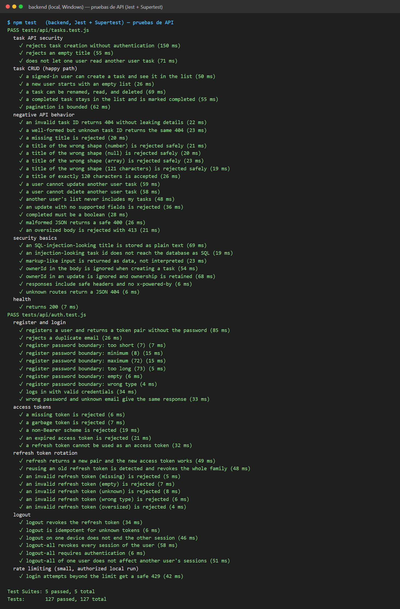

### Backend — pruebas unitarias
Validación de título y contraseña (valores límite y particiones), UUID, paginación y tokens JWT.

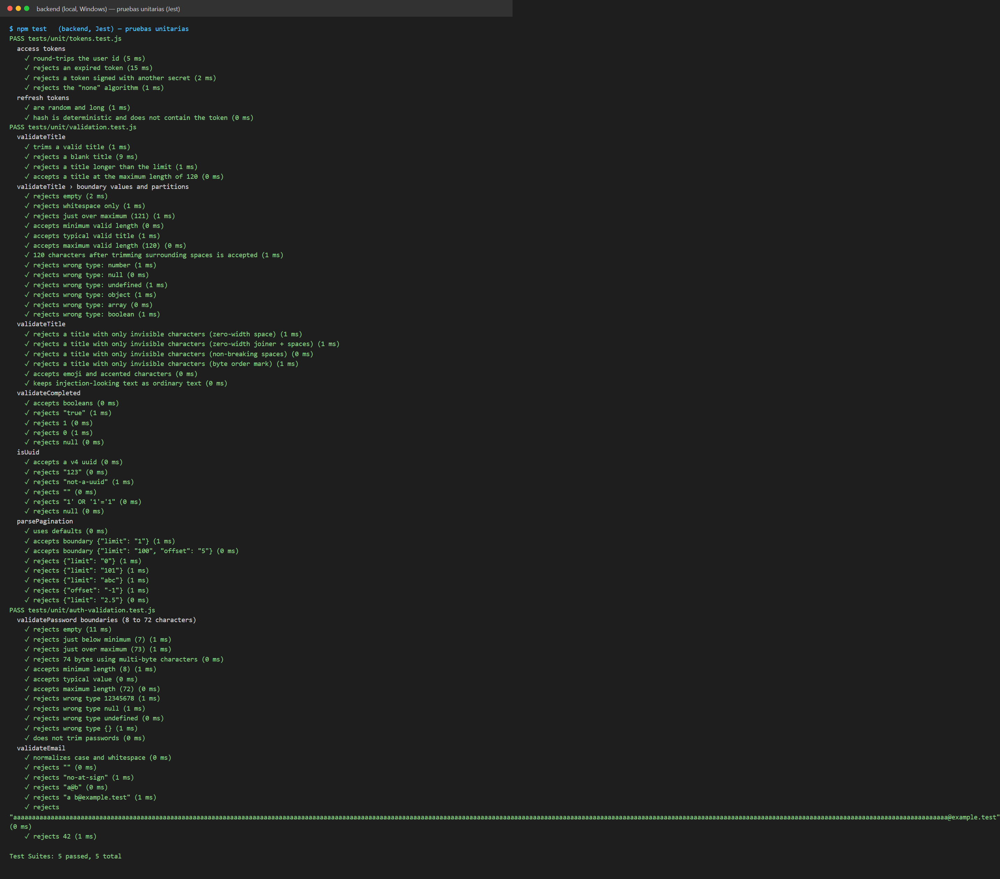

### Backend — cobertura
≈ 93 % de líneas. `migrate.js` (script de CLI) no se ejecuta en pruebas. La cobertura no prueba que se verificó el comportamiento correcto (ver [docs/11-ci-mocks-flaky.md](docs/11-ci-mocks-flaky.md)).

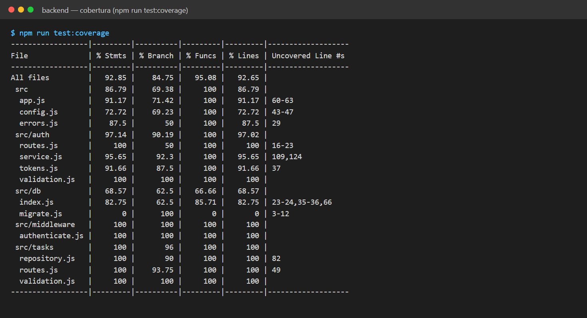

### Flutter — `flutter analyze` + 73 pruebas unitarias y de widgets

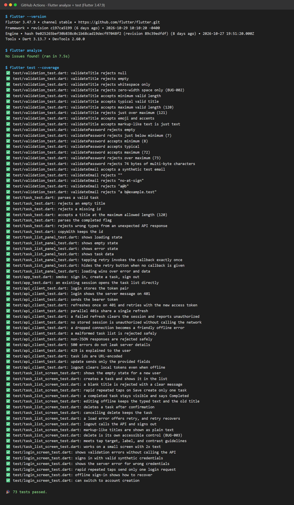

---

## 2. Integración continua (GitHub Actions)

Los 6 jobs en verde: backend contra PostgreSQL real y contra pg-mem, Flutter, compilación de APK Android, compilación web y k6.

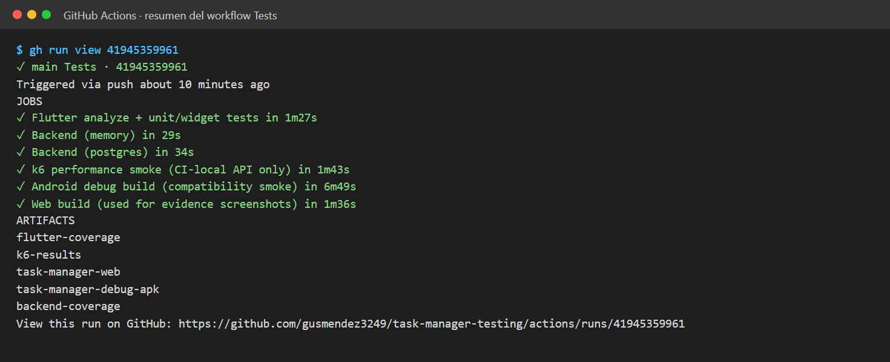

## 3. Rendimiento (k6, API efímera de CI)

Ambos scripts cumplen los umbrales: `p(95)` de 2.28 ms (`/health`) y 2.72 ms (lista autenticada) frente a un límite de 500 ms, y 0 % de errores.

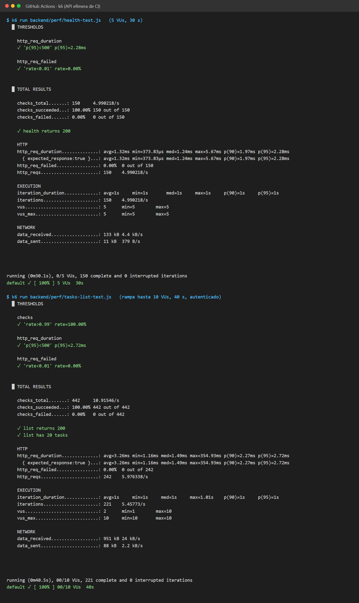

## 4. API — seguridad básica con curl

B recibe `404` al pedir la tarea de A, sin token se recibe `401`, se rechazan los títulos inválidos, la inyección SQL se guarda como texto, `ownerId` se ignora y el reuso de un refresh token se detecta.

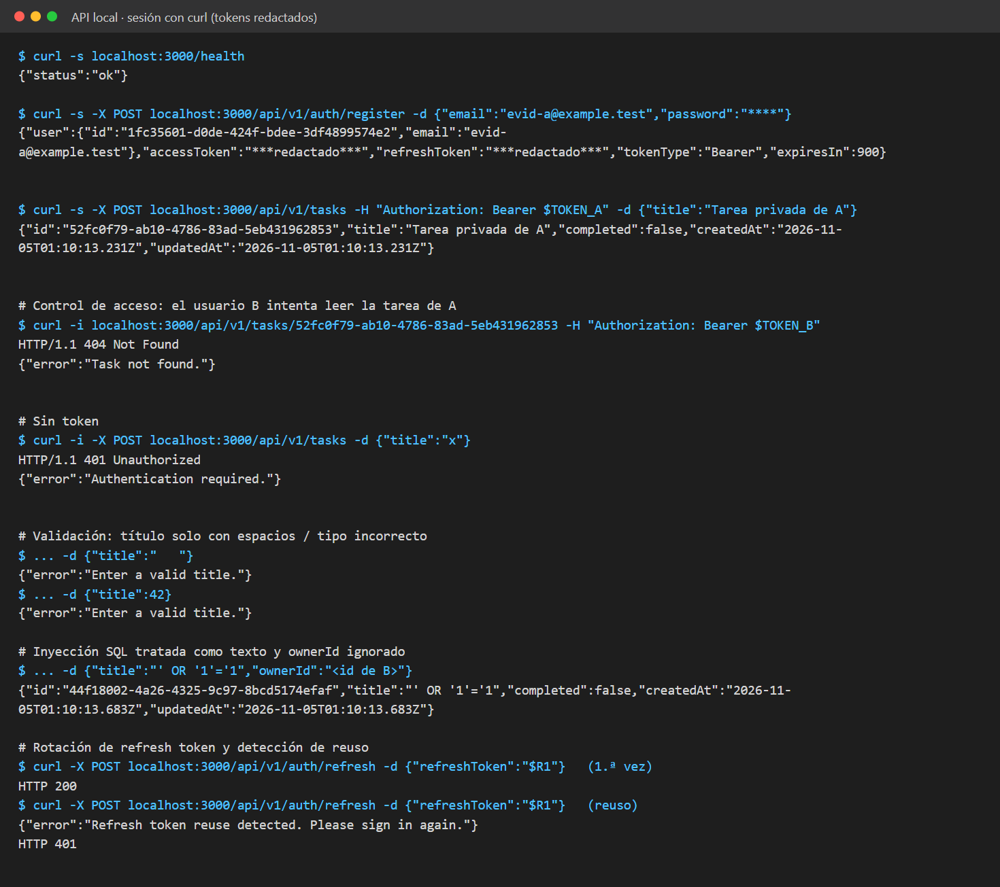

---

## 5. App — recorrido completo

| | | |
|:-:|:-:|:-:|
| **Login** | **Validación (sin llamar a la API)** | **Crear cuenta** |
| 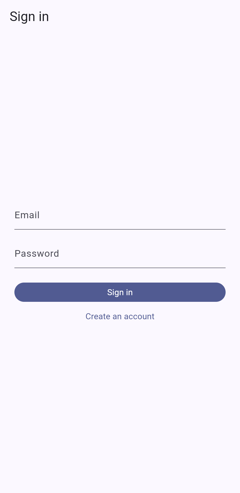 | 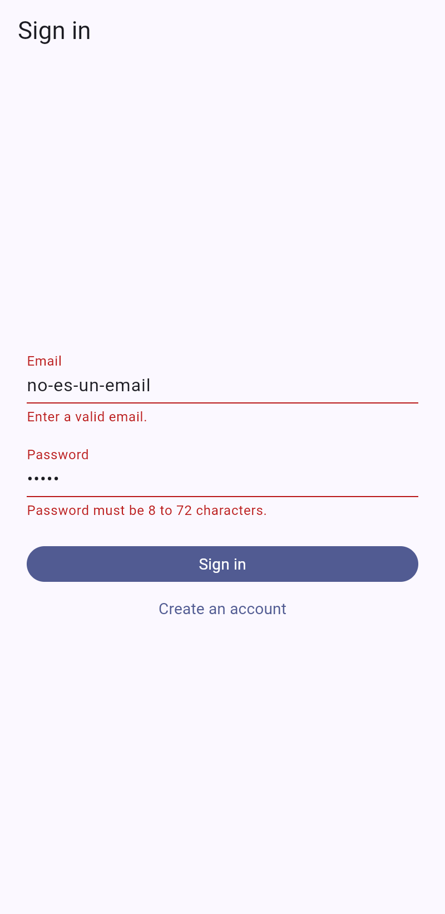 | 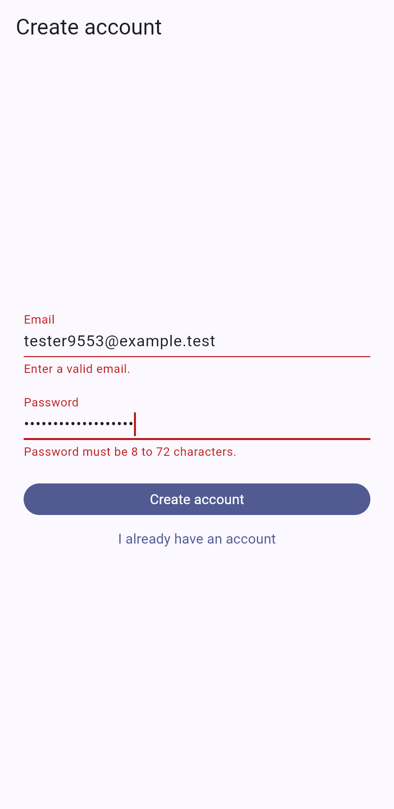 |
| **Estado vacío** | **Título vacío rechazado (AC-2)** | **Nueva tarea** |
| 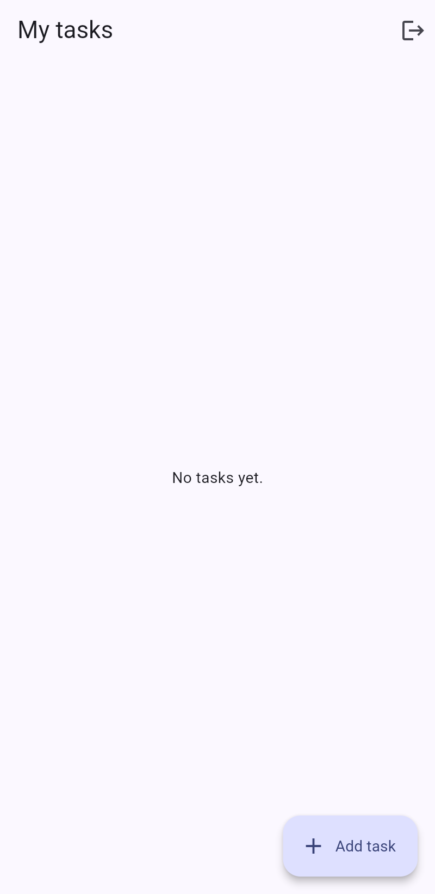 | 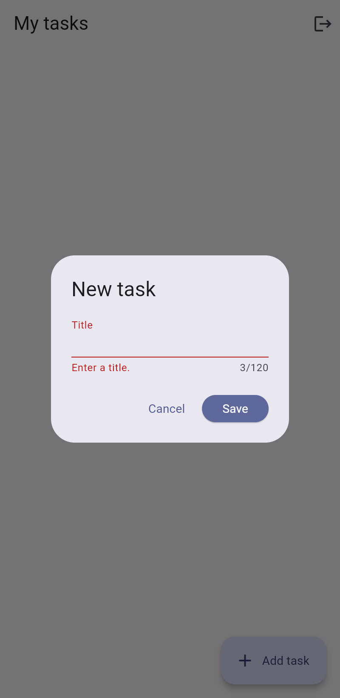 | 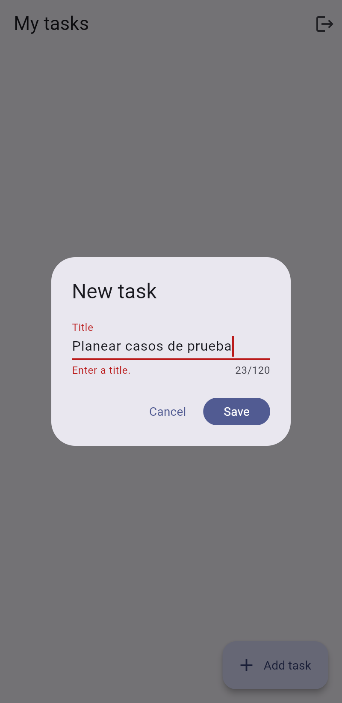 |
| **Lista de tareas** (`<script>` se muestra como texto) | **Tarea completada sigue visible (BUG-001)** | **Confirmación de borrado** |
| 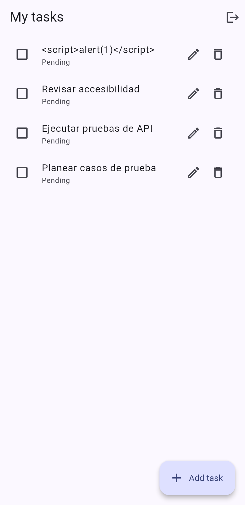 | 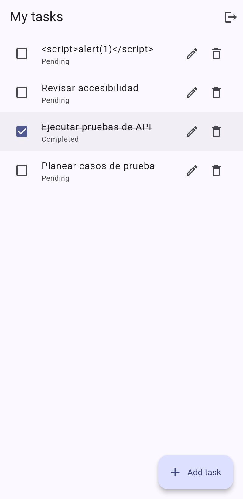 | 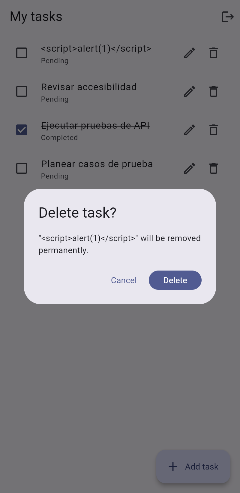 |
| **Edición sin conexión: error + texto conservado (TC-06)** | **Logout → pantalla de login** | |
| 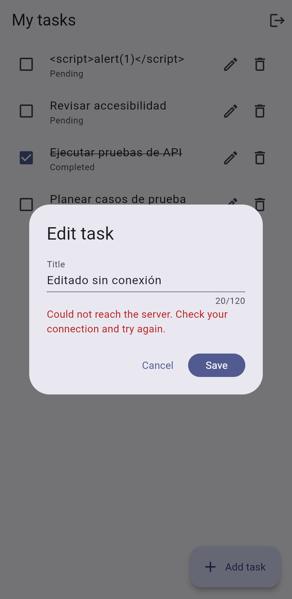 |  | |

---

## 6. Bug encontrado al tomar estas evidencias — BUG-003

Con el árbol de accesibilidad activo (como lo usan TalkBack y VoiceOver), activar **Borrar** en la primera tarea la **marcó como completada** y no abrió la confirmación. `CheckboxListTile` fusiona la semántica de sus hijos, así que Editar y Borrar no eran controles accesibles independientes.

| Antes (con el bug) | Después (corregido) |
|:-:|:-:|
| 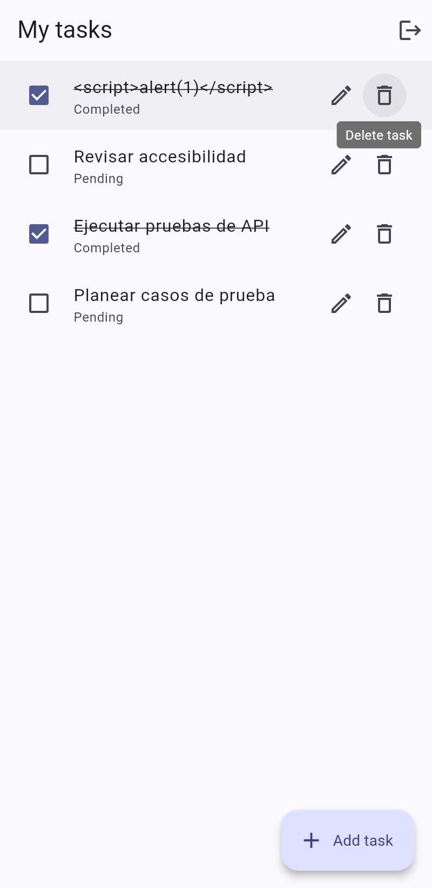 |  |

Corrección: `ListTile` con su propio `Checkbox`. Prueba de regresión: `mobile/test/task_list_screen_test.dart` › *delete is its own accessible control (BUG-003)*. Reporte completo en [docs/03-reporte-de-bug.md](docs/03-reporte-de-bug.md).
