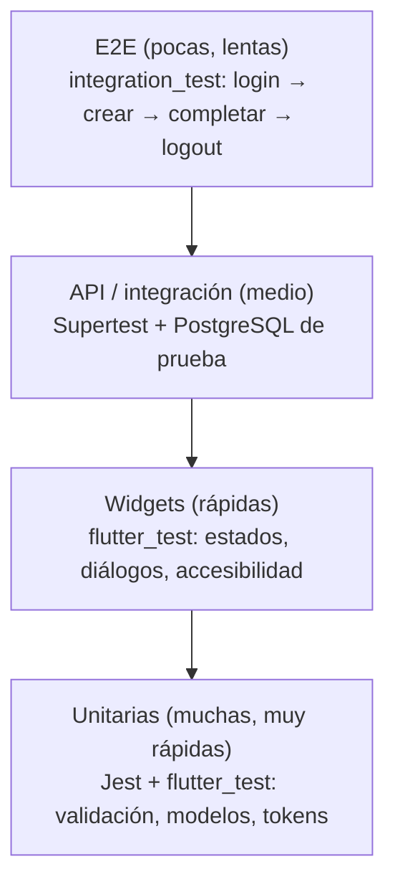

# 1. Mentalidad de tester y plan de pruebas

## Requisito analizado

> "Un usuario con sesión iniciada puede crear una tarea."

- **Quién lo usa:** cualquier usuario registrado desde la app móvil.
- **Resultado observable:** la tarea aparece en su lista (app) y `GET /api/v1/tasks` la devuelve (API).

### Criterios de aceptación (ejercicio de la sección 1)

| # | Tipo | Criterio | Prueba automatizada |
|---|------|----------|---------------------|
| AC-1 | Éxito típico | Una tarea con título válido se guarda y aparece en la lista. | `backend/tests/api/tasks.test.js` › *a signed-in user can create a task…*; `mobile/test/task_list_screen_test.dart` › *creates a task…* |
| AC-2 | Entrada inválida | Un título con solo espacios se rechaza con un mensaje claro (`400 Enter a valid title.` en API, *Enter a title.* en la app). | *rejects an empty title* (API y app) |
| AC-3 | Límite de permisos | Un usuario no puede ver la tarea de otra cuenta cambiando el ID (respuesta `404`, igual que si no existiera). | *does not let one user read another user task* |

## Pirámide de pruebas

| Nivel | Cantidad actual | Dónde |
|-------|-----------------|-------|
| Unitarias backend | 70+ | `backend/tests/unit` |
| API/integración | 55+ | `backend/tests/api` (corre contra pg-mem y PostgreSQL real en CI) |
| Unitarias + widgets Flutter | 60+ | `mobile/test` |
| E2E | 2 recorridos | `mobile/integration_test/app_test.dart` |

## Plan de pruebas (plantilla llenada)

| Campo | Notas |
|-------|-------|
| **Funcionalidad / release** | Task Manager v1.0.0: registro, login, CRUD de tareas, refresh de sesión, logout y logout-all. |
| **Alcance (incluido)** | API REST `/api/v1`, validación, autorización por dueño, rotación de refresh tokens, límites de tasa, app Flutter (login, lista, crear/editar/completar/borrar, logout), accesibilidad básica, compatibilidad Android. |
| **Alcance (excluido)** | Recuperación de contraseña (no existe), notificaciones, modo offline con cola de sincronización, despliegue en producción, pruebas de penetración profundas. |
| **Riesgos** | *Seguridad:* acceso a tareas ajenas (BOLA), robo de refresh token, fuerza bruta en login. *Datos:* pérdida de una edición sin conexión, tareas duplicadas por doble toque, tareas que "desaparecen" al completarse. *Disponibilidad:* API lenta con muchas tareas. *Usuario:* mensajes de error poco claros, controles sin etiqueta. |
| **Entorno de prueba** | API Node 22 + Express 5; PostgreSQL 17 (Docker local o servicio de CI); pg-mem para corridas rápidas; Flutter stable; emulador Android (API 34) y dispositivo físico. |
| **Datos de prueba** | Cuentas sintéticas `*@example.test`, contraseña `local-test-password`. La BD de prueba se vacía antes de cada prueba (`resetForTests`, que se niega a correr fuera de `NODE_ENV=test`/memoria). |
| **Tipos de prueba** | Unitarias, widgets, API/integración, E2E, exploratoria, valores límite, negativas/seguridad, rendimiento (k6), accesibilidad, compatibilidad, smoke y regresión. |
| **Criterios de entrada** | El código compila; `npm ci` y `flutter pub get` funcionan; BD de prueba disponible; cuentas de prueba creadas. |
| **Criterios de salida** | CI en verde (backend en Postgres y memoria, Flutter analyze + test, build APK, smoke k6 con umbrales); 0 defectos abiertos de severidad alta; checklist de regresión completo. |
| **Responsables** | Pruebas: estudiante QA. Correcciones: estudiante dev. Aprobación: docente. |
| **Evidencia** | Artefactos de GitHub Actions (cobertura, APK, resultados k6) y los documentos de `docs/`. Sin tokens ni contraseñas reales. |

## Priorización (impacto × probabilidad)

| Prioridad | Prueba | Por qué |
|-----------|--------|---------|
| P1 | Propiedad de tareas (leer/editar/borrar ajenas) | Fuga de datos de otros usuarios. |
| P1 | Login, refresh, reuso de token, logout | Si falla, nadie entra o un atacante se queda dentro. |
| P1 | Crear / completar tarea | Flujo principal; BUG-001 afectaba aquí. |
| P2 | Valores límite y tipos incorrectos | Errores 500 o datos basura. |
| P2 | Doble toque / sin conexión | Duplicados y pérdida de datos. |
| P3 | Accesibilidad, pantallas pequeñas, rendimiento | Afecta a grupos de usuarios y escalabilidad. |

## Qué queda sin probar

- iOS en dispositivo real (no hay Mac disponible); se documenta en la matriz de compatibilidad.
- El E2E necesita emulador + API local; no se ejecuta en CI (se corre manualmente, ver `mobile/README.md`).
- Lector de pantalla real (TalkBack/VoiceOver): checklist manual en `08-accesibilidad.md`.
